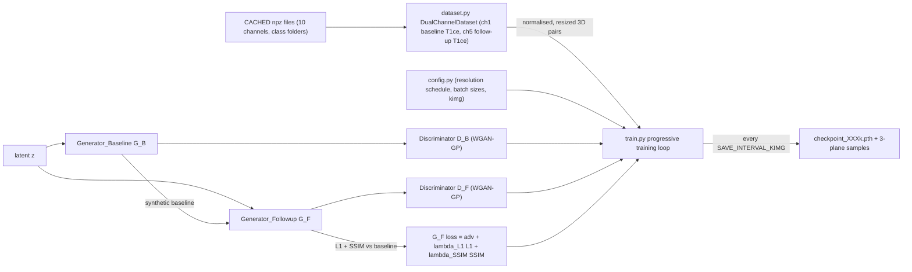

# Longitudinal Brain MRI Augmentation & Segmentation Pipeline  
*A Two-Generator PGGAN pipeline for synthetic longitudinal MRI generation, followed by 3D segmentation and RANO classification.*

---

🔗 **Research Paper (Overleaf Project):**  
https://www.overleaf.com/read/ympnckjqwkht#db481f
---

## Overview

This project provides an end-to-end pipeline for augmenting **longitudinal brain MRI data** using a  
**Two-Generator Progressive GAN (PGGAN)**.

The system generates anatomically consistent **baseline and follow-up** MRI image pairs.  
This synthetic data augments limited real datasets to improve:

- 3D Tumor Segmentation  
- RANO Classification Performance  

---


## How it works

The code in this repository is the Two-Generator PGGAN stage (`config.py`, `dataset.py`, `networks.py`, `train.py`). `DualChannelDataset` reads channel 1 (baseline T1ce) and channel 5 (follow-up T1ce) from each 10-channel `.npz`, normalises each to [-1, 1] and resizes to the current progressive-growing resolution. `train.py` grows both generators and both discriminators stage by stage (WGAN-GP, `LAMBDA_GP = 10`), adds L1 + SSIM consistency between the generated baseline and follow-up (`--lambda_l1`, `--lambda_ssim`), and writes `checkpoint_<kimg>k.pth` files plus 3-plane sample grids to the result directory.



The downstream steps described below (synthetic-data generation, 3D segmentation training, RANO classification) are part of the wider project; their scripts (`generate.py`, `train_cotrseg.py`, `train_classifier_radiomics.py`, etc.) are not in this repository at the moment.

---

##  End-to-End Flow

1. **Train GAN**  
   Train the Two-Generator PGGAN on preprocessed real MRI data from `CACHED128`.

2. **Generate Synthetic Data**  
   Use the trained GAN to generate synthetic baseline–follow-up pairs → saved in `generated1070`.

3. **Train Segmentation Model**  
   Train a 3D segmentation model (CoTrSeg / nnU-Net / DynUNet) on real MRI data.

4. **Inference on Synthetic Data**  
   Run the trained segmentation model on generated synthetic images → saved in `visualisation128aug`.

5. **Train RANO Classifier**  
   Train an XGBoost classifier using:
   - Real + synthetic images  
   - Corresponding segmentation masks  
   - Radiomics features  
   - SMOTE for class imbalance  

---

##  Key Features

###  Dual Generators
- **G_B (Baseline Generator)**  
  Generates baseline MRI from latent vector `z`.

- **G_F (Follow-Up Generator)**  
  Generates follow-up MRI from `(z + baseline features)` conditioned at all scales.

###  Dual Discriminators
- **D_B** → Discriminator for baseline MRI  
- **D_F** → Discriminator for follow-up MRI  
- Trained using **WGAN-GP** for stability.

### Loss = Adversarial + λ₁·L1 + λ₂·SSIM

Ensures:
- Anatomical consistency
- Temporal realism

---

###  3D Volume Support

All processing is done on:

128 × 128 × 128 3D MRI volumes

---

## 📁 Repository Structure

```bash
pggan/
├── config.py
├── dataset.py
├── networks.py
├── train.py
├── generate.py
├── utils.py
│
├── saved256/                     # Checkpoints & sample outputs
│   ├── samples/
│   └── checkpoint_XXXk.pth
│
├── generated1070/                # Generated synthetic .npz files
│   ├── 0/
│   ├── 1/
│   └── ...
│
├── CACHED128/                    # Preprocessed real dataset (10-channel .npz)
│   ├── 0/
│   ├── 1/
│   └── ...
│
models_cotrseg/
visualisation128aug/
│
├── train_cotrseg.py
├── dataset_seg_cotrseg.py
├── model_cotrseg.py
├── train_classifier_radiomics.py
│
├── requirements.txt
└── README.md
```
## 🧾 10-Channel `.npz` Mapping

Each `.npz` contains:

```python
vol.shape = (10, 128, 128, 128)
| Index | Channel          | Description                        |
|------:|------------------|------------------------------------|
| 0     | Baseline T1      |                                    |
| 1     | Baseline T1ce    | Used by GAN & Segmentation         |
| 2     | Baseline T2      |                                    |
| 3     | Baseline FLAIR   |                                    |
| 4     | Follow-Up T1     |                                    |
| 5     | Follow-Up T1ce   | Used by GAN & Segmentation         |
| 6     | Follow-Up T2     |                                    |
| 7     | Follow-Up FLAIR  |                                    |
| 8     | Baseline Mask    | 0:bg, 1:edema, 2:tumor             |
| 9     | Follow-Up Mask   | 0:bg, 1:edema, 2:tumor             |
```
## 🚀Quick Start

###  Install

```bash
git clone <your-repo-url>
cd <your-repo>

python -m venv venv
source venv/bin/activate      # Linux / macOS
# .\venv\Scripts\activate     # Windows

pip install -r requirements.txt
```
##  Pipeline Commands

### 1️⃣ Train Two-Generator PGGAN

```bash
python pggan/train.py \
  --config pggan/config.py \
  --data_root pggan/CACHED128 \
  --result_dir pggan/saved256 \
  --image_size 128 \
  --batch_size 4 \
  --epochs 200000
```
### 2️⃣ Generate Synthetic Dataset

```bash
python pggan/generate.py \
  --checkpoint pggan/saved256/checkpoint_XXXk.pth \
  --out_dir pggan/generated1070 \
  --n_samples 5000 \
  --seed 42
```
Each .npz contains:
(baseline_T1ce, followup_T1ce)

## Status

- Files present here: `config.py`, `dataset.py`, `networks.py`, `train.py`, `plan.html`, and the reference paper PDF. `generate.py`, `utils.py`, `requirements.txt` and the segmentation / classifier scripts listed in the structure above are not yet committed.
- `config.py` currently points at `DATA_ROOT = 'CACHED256'` with `IMAGE_SIZE = 256`; the README commands use 128. Adjust one or the other before training.
- No tests.

## 📜 License & Citation

Please cite this work if used in academic research.  
Refer to the Overleaf project for the full paper:

🔗 https://www.overleaf.com/read/ympnckjqwkht#db481f


